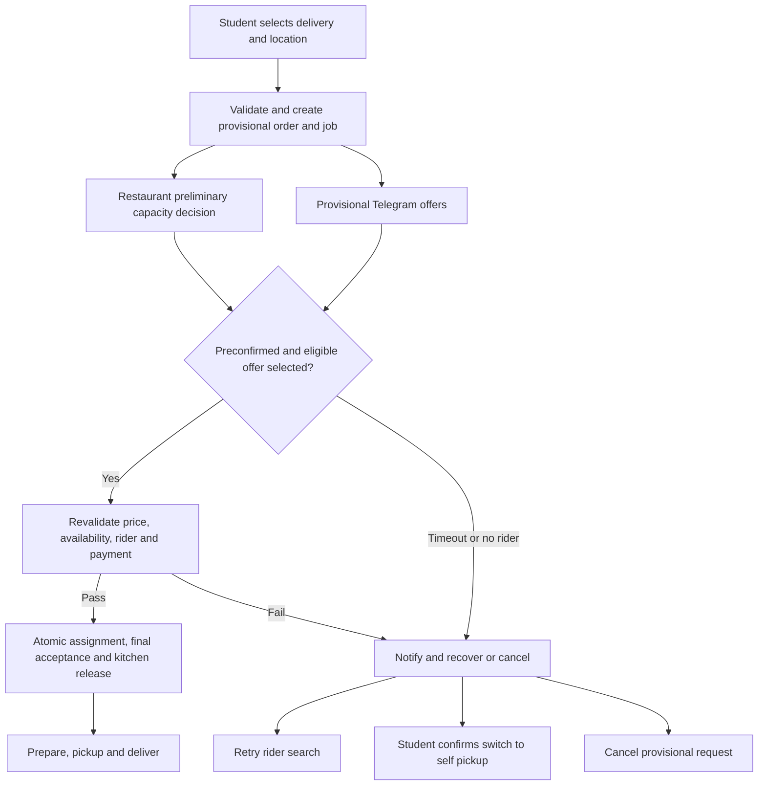

# UM Food --- Application Flows

**Document:** App Flow\
**Version:** 1.1\
**Status:** Working baseline\
**Scope:** Student app, restaurant POS/dashboard, kitchen display,
platform administration and Telegram delivery integration.

**Change history:** 1.1 — Daily menu confirmation and online availability; self pickup and provisional rider delivery with guarded kitchen release, payment boundaries and recovery.

## 1. Product overview

UM Food is a university-focused food ordering and restaurant operations
platform. It connects students, participating restaurants, restaurant
staff and an existing community delivery network.

### Confirmed product decisions

-   Backend: NestJS.
-   Student application: Next.js PWA.
-   Restaurant POS/dashboard: Next.js web application.
-   Platform administration: Next.js web application.
-   Database: PostgreSQL, accessed through Prisma.
-   Delivery integration: Telegram Bot API.
-   Ordering channels: student app and staff POS.
-   Fulfilment methods: dine-in, takeaway and delivery.
-   Dine-in ordering: staff-entered orders and student-app orders.
-   Pricing: predefined menu prices and authorised custom staff-entered
    prices.
-   Table QR ordering: excluded from the initial release.
-   The restaurant controls table assignment and seating confirmation
    for app-based dine-in orders.

## 2. Actors and permissions

  -----------------------------------------------------------------------
  Actor                               Main capabilities
  ----------------------------------- -----------------------------------
  Student/customer                    Browse, order, pay, track orders,
                                      manage favourites and reviews

  Restaurant owner                    Manage restaurant, staff, menu,
                                      pricing, reports and settings

  Restaurant manager                  Manage authorised restaurant
                                      operations

  Cashier                             Create POS orders, manage bills and
                                      record payments

  Waiter                              Open table sessions, add items and
                                      manage dine-in orders

  Kitchen staff                       View preparation tickets and update
                                      preparation status

  Rider                               Submit delivery offers and update
                                      assigned delivery status

  Platform administrator              Approve restaurants, manage users,
                                      handle disputes and monitor
                                      platform
  -----------------------------------------------------------------------

A user may hold more than one role. Permissions must be checked by the
backend and scoped to the relevant restaurant.

## 3. Student application flows

### 3.1 Registration and sign-in

1.  Student opens the application.
2.  Student registers using an email address.
3.  The platform verifies the email and applies the configured UM
    eligibility policy.
4.  Student completes their profile and contact details.
5.  Student signs in.
6.  Student may optionally grant location permission.
7.  Student lands on the home feed.

**Alternative paths:** email already registered, verification expired,
account disabled, password recovery, location permission denied.

### 3.2 Discover restaurants and food

1.  Student opens Home.
2.  App requests nearby results only if location permission is
    available.
3.  App displays open restaurants, popular items and personalised
    sections.
4.  Student searches by restaurant, dish or category.
5.  Student applies filters such as price, cuisine, distance and
    fulfilment availability.
6.  Student opens a restaurant.
7.  App displays menu, prices, availability, operating hours and
    fulfilment options.

If location is unavailable, use a selected campus area or a general UM
restaurant listing. Do not block browsing.

### 3.3 Build a cart

1.  Student selects a menu item.
2.  Student chooses required variants and optional add-ons.
3.  Student enters quantity and item notes.
4.  App validates availability and displays the calculated line total.
5.  Student adds the item to the cart.
6.  Student reviews the cart.
7.  App validates that the cart contains items from one restaurant.
8.  Student proceeds to checkout.

**MVP rule:** one cart/order belongs to one restaurant. Multi-restaurant
checkout is deferred.

### 3.4 Dine-in order

1.  Student selects a restaurant and chooses **Dine-in**.
2.  App explains that table assignment is confirmed by restaurant staff.
3.  Student places the order and selects an available payment method.
4.  Restaurant POS receives the order.
5.  Restaurant staff accepts or rejects it.
6.  If accepted, staff assigns a table or instructs the student where to
    sit.
7.  Kitchen receives preparation tickets.
8.  Staff updates the order as preparing and then served.
9.  Student receives status updates.
10. Payment is completed according to the restaurant's configured
    policy.
11. Order and any associated bill are closed.

**Important:** App-based dine-in does not reserve a table automatically.
No table QR scan is used in the MVP.

### 3.5 Self Pickup (TAKEAWAY)

1. Student chooses Self Pickup, selects available items and reviews checkout. The backend validates current prices, restaurant status, online acceptance, fulfilment eligibility and availability.
2. The order goes directly to the POS as `PENDING_RESTAURANT`; staff accept or reject it. No rider job or Telegram request is created.
3. After acceptance and any required payment confirmation, a kitchen ticket is released. Staff prepare and mark Ready for Collection; the student is notified, collects it, and staff complete the order.

### 3.6 Rider Pickup / Delivery (DELIVERY)

The student chooses delivery and an eligible location. The backend validates current price, menu, restaurant operating and acceptance status and fulfilment eligibility, then creates a `PROVISIONAL` order and delivery job. Staff receive a preliminary capacity request and supply a decision and estimated preparation duration; this is not final acceptance. A clearly provisional, privacy-minimised Telegram request collects rider offers, potentially in parallel. No ticket or preparation is permitted.

The student sees each eligible offer's fee, rider identity, expiry and pickup arrival estimate only when reliable, and selects one. The backend checks current availability, price, restaurant preconfirmation and expiry, rider and offer eligibility, and payment conditions. A single transaction secures one rider, records final restaurant acceptance, commits the order and releases the ticket; the restaurant receives the final order and the assigned rider receives necessary private pickup/drop-off information. Staff prepare, the rider picks up and delivers, and the order and separate delivery-fee records are reconciled. Manual availability does not reserve stock: a final check is mandatory.

Pilot starting timeout ranges, configurable and subject to testing: restaurant preconfirmation 30–45 seconds, offer collection 60–90 seconds, student selection 30–60 seconds, assignment confirmation 15–30 seconds. No rider: offer retry, explicit switch to Self Pickup, or cancellation. On switch, close the job, remove uncommitted delivery fee, recalculate and revalidate before creating the pickup order; prevent duplicate committed orders. Never silently convert.

Telegram outage leaves the request in PostgreSQL and informs the student; an authorised operator may dispatch manually only with equivalent eligibility, assignment and release checks. If a rider cancels before preparation, hold any released but unstarted ticket and reopen search or offer the alternatives; a replacement rider reactivates that ticket after checks. An approved pickup switch cancels the committed delivery order and its held ticket before creating a linked pickup order, with payment review. After preparation starts, urgently reassign or escalate to an authorised operator. Track cancellation/refund decisions separately before restaurant confirmation, before assignment, after assignment but before preparation, during preparation, and after pickup; liability and compensation are open policy decisions. Do not promise a refund amount before policy approval.

Cash may remain pending when the configured payment terms permit collection later. Manual QR/bank transfer requiring advance payment must be confirmed by authorised staff before release; a QR display, screenshot or declaration is not confirmation. Pending or failed required payment holds release and prompts resolution or cancellation. Record food and rider fees separately, including pending, confirmed, failed, refund required and refund completed, independently of order/delivery status.

### 3.7 Order history and reorder

1.  Student opens Orders.
2.  App displays active, completed and cancelled orders.
3.  Student opens an order to view items, status, receipt and payment
    details.
4.  Student may reorder available items from the same restaurant.
5.  Current menu prices and availability are revalidated before
    checkout.

### 3.8 Favourites, reviews and recommendations

-   Student can favourite/unfavourite restaurants and items.
-   Student can rate eligible completed orders.
-   Reviews are subject to moderation and platform rules.
-   Home feed records recommendation impressions and clicks.
-   Student can manage location and personalisation preferences.

## 4. Restaurant POS flows

### 4.1 Restaurant onboarding

1.  Owner creates an account.
2.  Owner submits restaurant details and required supporting
    information.
3.  Platform administrator reviews the application.
4.  Restaurant is approved, rejected or asked for more information.
5.  Owner configures locations, operating hours and fulfilment methods.
6.  Owner creates menu categories, items, variants, add-ons and pricing.
7.  Owner invites staff and assigns roles.
8.  Restaurant is activated for the permitted services.

### 4.2 Staff sign-in and shift opening

1.  Staff signs in.
2.  Backend checks staff membership and permissions.
3.  Cashier opens a shift if cash handling is enabled.
4.  Cashier records opening cash float.
5.  POS displays active orders, tables and quick actions.

### 4.3 Walk-in takeaway order

1.  Cashier selects New Order.
2.  Cashier selects Takeaway.
3.  Cashier adds products, quantities, variants and notes.
4.  Cashier may add an authorised custom-price item or override.
5.  POS calculates subtotal, discounts and configured charges.
6.  Cashier confirms the order.
7.  Backend creates order and order items.
8.  Kitchen tickets are generated.
9.  Cashier records payment or marks the order as payable later if the
    restaurant permits it.
10. Order progresses to Ready and Collected.

### 4.4 Staff-created dine-in order

1.  Waiter opens Table Management.
2.  Waiter selects an available table.
3.  Backend opens a dining session.
4.  Waiter adds items and submits an order.
5.  Kitchen tickets are generated.
6.  Customer may request additional items.
7.  Waiter adds another order to the same dining session.
8.  POS updates the open bill.
9.  Customer requests the bill.
10. Cashier generates/reviews the bill.
11. Customer pays in one or more payments.
12. Backend verifies that the bill balance is zero.
13. Dining session is closed and table becomes available.

### 4.5 Student-app order handling

1.  POS receives an incoming online order.
2.  Staff reviews items, fulfilment type and requested instructions.
3.  Staff accepts or rejects the order with a reason.
4.  Accepted pickup/dine-in order enters the kitchen only after applicable payment conditions; delivery follows the guarded final confirmation in section 3.6.
5.  Staff updates preparation status.
6.  For dine-in, staff assigns a table or seating instruction.
7.  For takeaway, staff marks Ready and then Collected.
8.  For delivery, staff first preconfirm capacity; final acceptance and kitchen release follow secured assignment and payment checks.
9.  POS and student app receive status updates.

### 4.6 Custom pricing

1.  Staff selects an item configured to permit custom pricing, or adds
    an open-price line.
2.  POS checks the staff member's permission.
3.  Staff enters unit price and quantity or weight.
4.  Staff enters a reason if required by restaurant policy.
5.  Backend validates price bounds and permissions.
6.  Backend stores original price, final price, actor and timestamp.
7.  Order line total is calculated server-side.

### 4.7 Table management

Table states may include:

-   AVAILABLE
-   OCCUPIED
-   RESERVED (if reservations are enabled later)
-   CLEANING
-   OUT_OF_SERVICE

A dining session is the source of truth for an occupied table. Table
status must not be changed to available while an unsettled session
remains open unless an authorised transfer/closure workflow is used.

Supported operations:

-   Open session.
-   Add order.
-   View current bill.
-   Transfer session to another table.
-   Merge sessions where permitted.
-   Split bill.
-   Close session.
-   Mark table cleaning and available.

Table QR ordering and QR table identification are not part of the MVP.

### 4.8 Kitchen workflow

1.  Confirmed order generates one or more kitchen tickets.
2.  Ticket is routed to configured preparation station(s).
3.  Kitchen staff views ticket, items, quantities and notes.
4.  Staff marks ticket In Progress.
5.  Staff marks ticket Ready.
6.  POS aggregates ticket status into order status.
7.  Service staff delivers/collects food and updates the fulfilment
    state.

A single customer order may create separate tickets for kitchen, drinks
or dessert stations.

### 4.9 Billing and payments

1.  Cashier opens an unpaid bill.
2.  Cashier reviews bill items, discounts and charges.
3.  Cashier selects payment method.
4.  Cashier records full or partial payment.
5.  Backend creates payment and allocation records.
6.  Backend recalculates outstanding balance.
7.  Bill becomes PAID only when its balance is zero and payment records
    meet the configured confirmation rules.
8.  Refunds and voids require permissions and audit records.

A displayed QR or transfer instruction is not proof of payment. Manual
QR transfer confirmation must be recorded by an authorised staff member
until a verified payment gateway/webhook is integrated.

### 4.10 Shift closing

1.  Cashier opens shift summary.
2.  POS calculates expected cash from opening float, cash sales, refunds
    and recorded cash movements.
3.  Cashier enters actual cash count.
4.  POS calculates discrepancy.
5.  Cashier submits shift close.
6.  Manager reviews exceptions where required.
7.  Shift becomes closed and immutable except through audited correction
    workflows.

## 5. Rider and Telegram flows

### 5.1 Rider onboarding

1.  Rider starts the official bot.
2.  Bot links Telegram account to a platform rider profile through a
    secure one-time linking flow.
3.  Platform verifies required identity and eligibility information
    according to policy.
4.  Rider accepts platform terms.
5.  Rider becomes eligible to submit offers.

Do not expose student phone numbers or exact drop-off details to the
whole Telegram group.

### 5.2 Offer and assignment

-   Bot posts a minimal request clearly marked provisional, without customer contact or precise personal drop-off details.
-   Rider submits an offer amount.
-   Backend validates job state and offer deadline.
-   Student sees valid offers.
-   Student selects an offer.
-   Backend uses a transaction/conditional update to assign exactly one
    rider.
-   Other offers are closed.
-   Bot edits or replies to the group message with assignment status.
-   Private details are sent only to the assigned rider after they have
    initiated the bot.

### 5.3 Delivery status

Allowed transitions:

`REQUESTED → OFFERING → ASSIGNED → PICKED_UP → DELIVERED → COMPLETED` (with `OFFERING` re-entered on eligible reassignment).

Alternative terminal or exception states:

`EXPIRED`, `CANCELLED`, `DISPUTED`.

Only authorised actors can perform each transition. Every transition is
recorded with actor, timestamp and source.

## 6. Platform administration flows

-   Review restaurant applications.
-   Suspend/reactivate restaurants.
-   Manage user and rider eligibility.
-   Review reports and disputes.
-   Configure platform-wide settings.
-   Monitor order and delivery failures.
-   View audit logs.
-   Manage featured content and moderation.
-   Review operational metrics.

## 7. Cross-cutting rules

-   One food order belongs to one restaurant.
-   Source and fulfilment type are separate fields.
-   Food payment and delivery-fee payment are separate financial
    records.
-   Order status and payment status are independent.
-   Dining sessions, orders, kitchen tickets, bills and payments are
    separate entities.
-   Server is authoritative for prices, totals, permissions and state
    transitions.
-   All important state changes are audited.
-   Telegram is an integration channel, not the source of truth.
-   No table QR ordering in the initial release.

## 8. Daily menu availability and online opening

At each restaurant-local business day opening, an owner or authorised manager reviews the configured menu and latest known availability, individually or in bulk marks items available, sold out or temporarily unavailable, and confirms the day. Yesterday's sold-out state is never reset automatically. Staff then explicitly enable online acceptance; business hours and this switch are distinct. They may pause/resume online orders independently, and change items throughout the day. The POS records actor and time for each change; backend permissions and tenant ownership apply. Authorised walk-in POS operations continue when online orders are paused.

Students see available items with details and price and can add them to cart. Unavailable items stay visible with Sold out or Temporarily unavailable and disabled Add to Cart. If a cart item changes, notify the student and require an updated cart. NestJS validates and persists changes, records audit history, and emits WebSocket updates to authorised POS and student subscribers; reconnect, refresh and checkout revalidate from the server if events are missed. Manual flags do not reserve portions. Quantity decrement and inventory are future enhancements.
